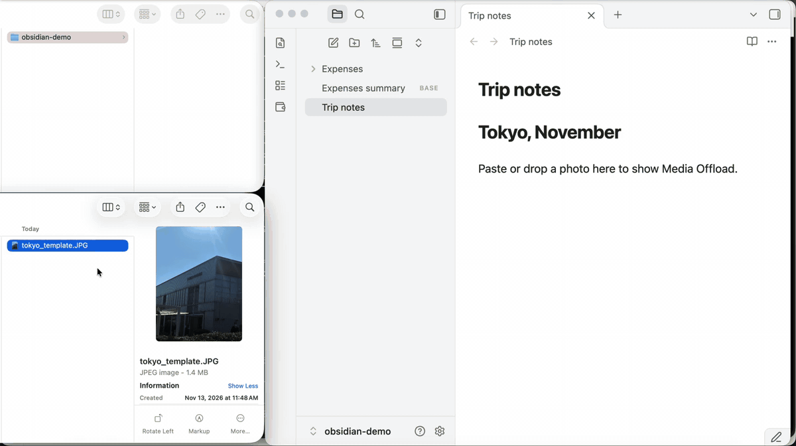

# Media Offload

**Keep images and videos out of your vault.** Paste or drop one into a note: it shows up as usual, but the file is kept in a folder outside the vault. Your vault stays small and quick to sync and back up.

[中文说明](#中文说明)

## What it does

- **Paste or drop, nothing lands in the vault.** Screenshots and images copied from the web are saved to your media folder (default `~/Obsidian Media/<vault name>`), and the note links to them.
- **Or link files where they are.** Turn on **Link files from your computer where they are**, and a photo you drop from Finder or Explorer is linked in place, with no copy at all.
- **Each file is stored once.** Paste the same image twice and you still have one file.
- **Tidies up after other plugins.** If an image or video still ends up in the vault, it is moved to the media folder and the links are updated.
- **Resize images** by dragging their right edge.

## Good to know

- Desktop only. Images don't show on mobile.
- Links point to files on this computer. On another computer they show only if the files are at the same path.
- Obsidian Sync, iCloud and Git don't copy the media folder. Keep it in a folder you already back up.
- If you link files in place, moving, renaming or deleting the original breaks the link.

## Privacy

The plugin reads and writes files outside the vault, which is its job. It only writes inside your media folder, never deletes anything outside the vault (attachments it moves out of the vault go to Obsidian's trash), and makes no network requests.

## License

MIT

---

## 中文说明

**图片和视频不进 vault。** 往笔记里粘贴或拖进图片，照常显示，但文件存在 vault 外面的文件夹里。vault 一直很小，同步、备份都快。

- **粘贴、拖入，vault 里不多文件**：截图、网页上复制的图片存到媒体文件夹（默认 `~/Obsidian Media/<vault 名>`），笔记里放链接。
- **也可以直接引用原图**：打开「电脑里的文件直接引用原位置」，从访达或资源管理器拖进来的照片直接链接原文件，不复制。
- **同一个文件只存一份**：同一张图粘两次，也只有一个文件。
- **帮别的插件收拾**：如果还是有图片视频进了 vault，会自动搬到媒体文件夹并改好链接。
- **拖图片右边缘调大小。**

**注意**

- 只支持电脑，手机上看不到图。
- 链接指向这台电脑上的文件，换电脑要路径相同才能显示。
- Obsidian Sync、iCloud、Git 不会同步媒体文件夹，请放在本来就有备份的位置。
- 直接引用原图时，原文件移动、改名或删掉，链接就失效。

**隐私**：插件会读写 vault 外的文件，这是它的用途。只写你的媒体文件夹，不删 vault 外的任何东西（搬出 vault 的附件放进 Obsidian 回收站），不联网。
